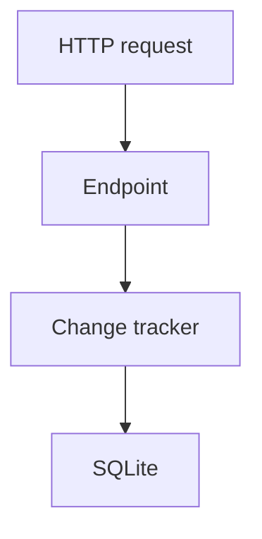
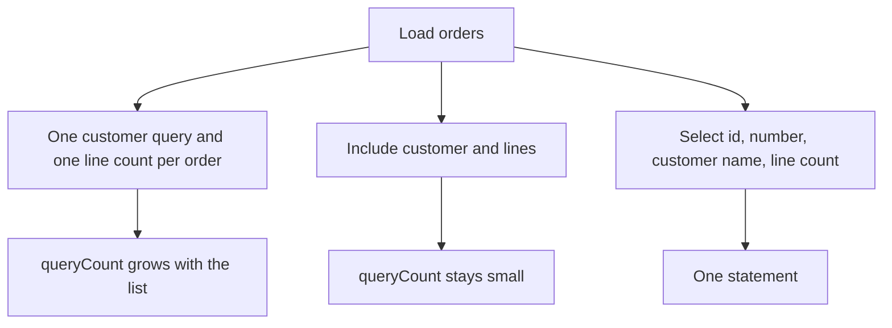
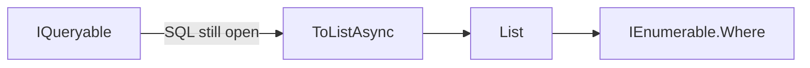

# lab-ef-core

ASP.NET Core API that reads and updates orders with EF Core on SQLite. The list endpoints return the same rows and report how many SQL statements each approach used.

HTTP on port **5021**. Swagger UI in Development: [http://localhost:5021/swagger](http://localhost:5021/swagger).

## Run

```powershell
dotnet run --project src/LabEfCore.Api
dotnet test
```

Open `LabEfCore.slnx` and start the `http` profile. The first run creates `sales.db` next to the project and seeds three customers and four orders. That file is local and is not part of the repository.

## Request map



`MapGet` and `MapPost` register the routes. EF translates LINQ to SQL, materializes entities, and tracks them unless the query uses `AsNoTracking` or a projection that does not return entities.

## Query shape

`queryCount` on each list response is the number of SQL statements for that request.



| Path | What it does |
| --- | --- |
| `GET /orders/n-plus-one` | Loads orders, then asks for the customer name and the line count of each order. |
| `GET /orders/include` | Loads orders together with `Customer` and `Lines`. |
| `GET /orders/projected` | Selects only the four fields the response needs. |

The row shape is the same. The statement count is not. A projection also avoids materializing columns and related rows the caller does not use.

## IQueryable, IEnumerable, and List

`DbSet<Order>` is an `IQueryable<Order>`. `Where` and `Select` on it build a command. Nothing hits SQLite until `ToListAsync`. That call returns a `List`.

`OrderQueries` keeps filters on `IQueryable` so they still compose. `ForCustomerInMemory` takes `IEnumerable` and runs after the list exists.



| Path | Query `customer=Ada Bakery` | What happens |
| --- | --- | --- |
| `GET /orders/composed` | Required | `Where` stays on `IQueryable`. SQL returns 2 rows. `loadedCount` is 2. `execution` is `database`. |
| `GET /orders/in-memory` | Required | The full list is loaded, then `Where` runs in the process. `loadedCount` is 4. `execution` is `memory`. |

Both return the two Ada Bakery orders. Both use one SQL statement. Only `loadedCount` shows that the second one moved the whole table into the process.

## Change tracking

| Path | Behavior |
| --- | --- |
| `POST /orders/{id}/note` | The order is tracked. Assigning `Note` and calling `SaveChanges` writes an UPDATE. `savedChanges` is 1. |
| `POST /orders/{id}/note/detached` | `AsNoTracking` leaves the instance detached. Changing `Note` in memory does not schedule an UPDATE. `savedChanges` is 0 and `databaseNote` stays as stored. |

Body for both:

```json
{ "note": "packed" }
```

`id` is the order id from a list response.

## Endpoints

| Method | Path | Result |
| --- | --- | --- |
| GET | `/health` | 200 liveness. No database check. |
| GET | `/orders/n-plus-one` | Rows plus a query count that grows per order. |
| GET | `/orders/include` | Same rows, related data loaded with the orders. |
| GET | `/orders/projected` | Same rows, one selective statement. |
| GET | `/orders/composed?customer=` | Filter in SQL. `loadedCount` equals the result size. |
| GET | `/orders/in-memory?customer=` | Filter on the `List`. `loadedCount` is every order. |
| POST | `/orders/{id}/note` | Persists `note` on a tracked entity. 404 when the id is missing. |
| POST | `/orders/{id}/note/detached` | Does not persist `note`. 404 when the id is missing. |

## Configuration

`ConnectionStrings:Sales` selects the SQLite file. The default is `Data Source=sales.db`. In Development, EF logs each command at Information.

SQLite keeps this service runnable with the SDK alone. The query and tracking behavior above is the part to rely on. Locking, isolation, and execution plans belong to the engine you run in production.

---

I hope the query shapes and tracking rules in this repository help you keep list endpoints cheap and updates predictable.

Sevann Radhak
