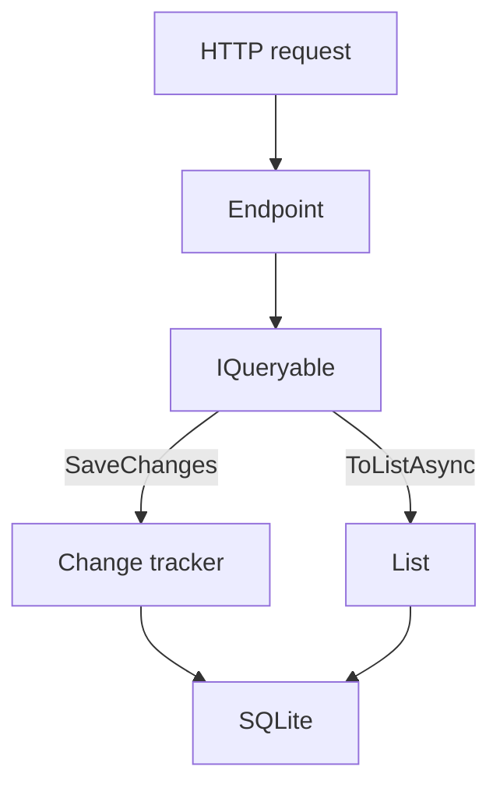
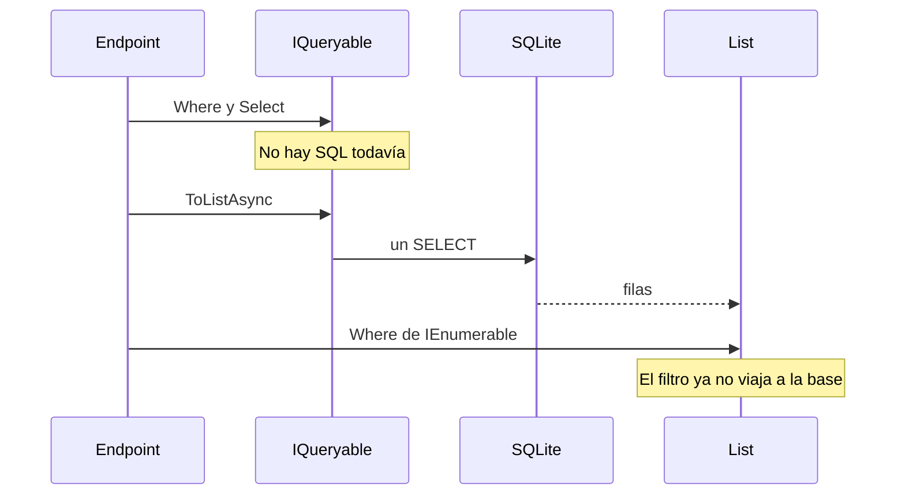
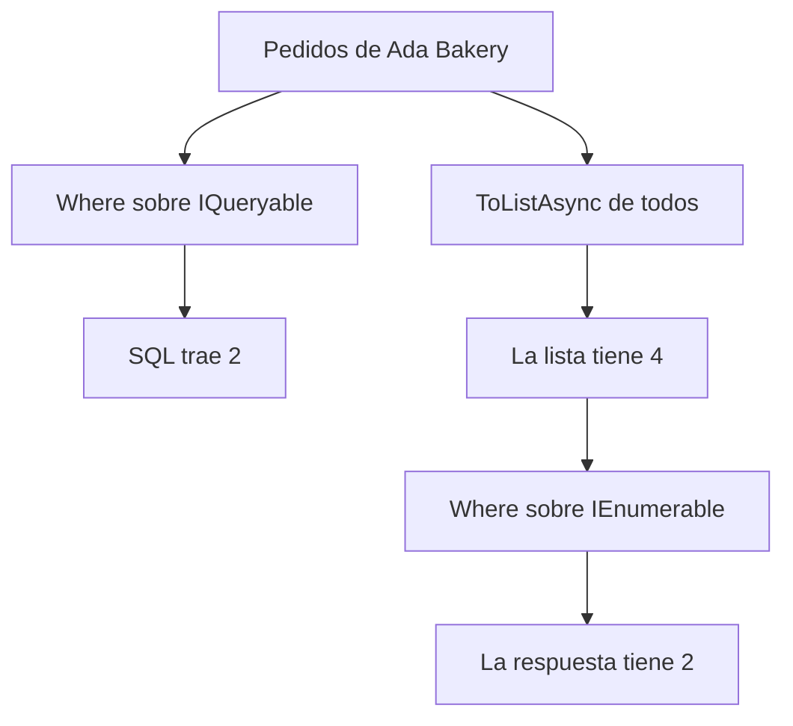
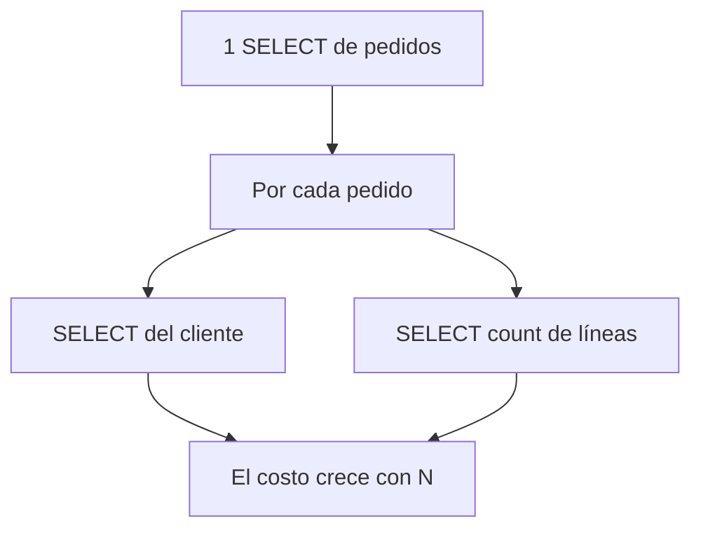
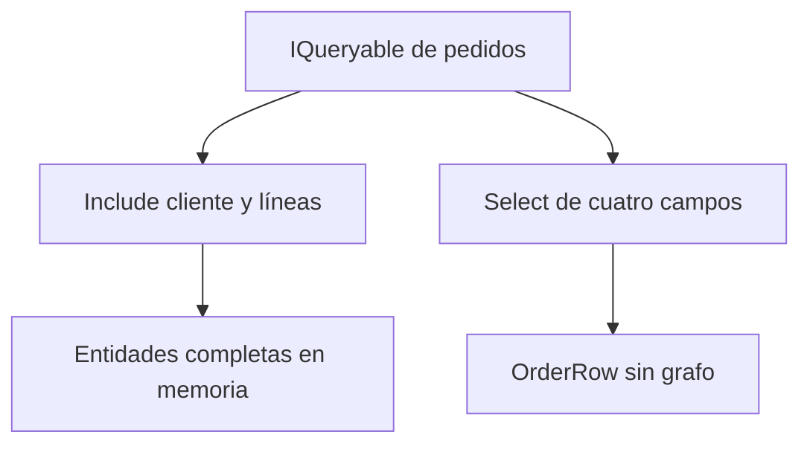
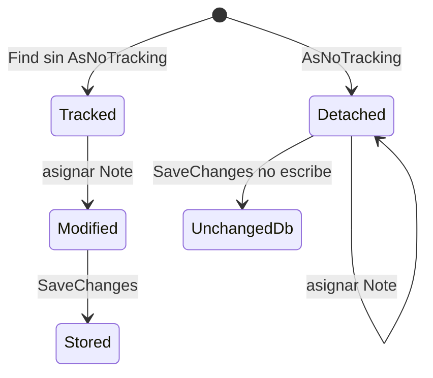

# Conceptos — EF Core y consultas

Cada listado de pedidos devuelve filas y un `queryCount`: cuántos SQL ejecutó ese request. En Development la consola imprime el texto de cada comando.

SQLite está para correr con el SDK. Lo que sigue vale igual en SQL Server: cuándo se arma el SQL, cuándo se ejecuta, y cuándo un objeto en memoria se escribe.

## Mapa del request



`MapGet` y `MapPost` solo registran rutas. No arman SQL. El SQL nace cuando un `IQueryable` se ejecuta.

## 1. IQueryable, IEnumerable y List

Son tres momentos de la misma idea, no tres listas parecidas.

| Tipo | Qué es acá | Cuándo corre el filtro |
| --- | --- | --- |
| `IQueryable<Order>` | `db.Orders` y lo que devuelve `OrderQueries.ForCustomer` | Todavía no. `Where` se suma al comando. |
| `List<OrderRow>` | Lo que devuelve `ToListAsync` | Ya corrió. Las filas están en el proceso. |
| `IEnumerable<OrderRow>` | Lo que devuelve `ForCustomerInMemory` | En memoria, sobre la lista que ya llegó. |



`GET /orders/composed?customer=Ada Bakery` deja el `Where` sobre `IQueryable`. El SQL trae 2 pedidos. `loadedCount` es 2 y `execution` es `database`.

`GET /orders/in-memory?customer=Ada Bakery` primero materializa los 4 pedidos y después filtra. También devuelve 2, y también un solo SQL. `loadedCount` es 4 y `execution` es `memory`. El `queryCount` no alcanza para ver este error: los dos valen 1. El dato que lo delata es `loadedCount`.



**Regla.** Componé filtros, orden e `Include` mientras el tipo siga siendo `IQueryable`. Llamá `ToListAsync` cuando la forma del resultado ya está cerrada. Un método que acepta `IEnumerable` obliga a ejecutar antes: el `Where` de adentro ya no puede ser SQL.

**Falla típica.** Un helper `Filter(IEnumerable<Order> orders, ...)` recibe `db.Orders`. El compilador acepta el `IQueryable` porque implementa `IEnumerable`, pero el `Where` pasa a LINQ to Objects. La base manda la tabla entera.

## 2. N+1



Con 4 pedidos y dos lecturas por pedido, el request no cuesta 1 statement. Cuesta 1 + 8. `GET /orders/n-plus-one` hace ese `foreach` a propósito. `ToListAsync` ya cortó el `IQueryable`. Cada `FirstAsync` y cada `CountAsync` es otro comando.

**Por qué no se ve en chico.** Cuatro filas responden al instante. Con miles de pedidos el tiempo se va en idas a la base.

**Falla típica.** Un listado se puso lento cuando creció el catálogo. El log mostraba una consulta por fila. Una proyección lo dejó en un statement.

## 3. Include y proyección



`GET /orders/include` agrega las relaciones al `IQueryable`. No hay un round-trip por fila. Sí materializa `Customer` y `OrderLine`. El `Select` que arma `OrderRow` corre después, sobre la `List`: ya es `IEnumerable`.

`GET /orders/projected` llama a `OrderQueries.Project`. El `Select` sigue siendo `IQueryable<OrderRow>` hasta el `ToListAsync`. SQL pide id, número, nombre y cantidad de líneas. No se construye el grafo.

**Regla.** Si la pantalla usa cuatro campos, proyectá esos cuatro. `Include` cuando el código de verdad usa las entidades. Los listados de lectura usan `AsNoTracking`: nadie va a llamar `SaveChanges` con esos objetos.

## 4. Change tracking

EF envuelve la entidad si la consulta devuelve la entidad, sin `AsNoTracking`. Cambiar una propiedad la marca `Modified`. `SaveChanges` escribe solo eso.



| Ruta | Estado | `savedChanges` |
| --- | --- | --- |
| `POST /orders/{id}/note` | Tracked, después Modified | 1 |
| `POST /orders/{id}/note/detached` | Detached | 0 |

**Falla típica.** Se cargó con `AsNoTracking` para ahorrar memoria, se modificó el objeto y se llamó `SaveChanges`. No hay excepción. Tampoco hay `UPDATE`. Al recargar, el valor viejo sigue ahí.

## Dónde poner breakpoints

1. `OrderQueries.ForCustomer` y `OrderQueries.Project`. Todavía no hay SQL. El árbol se está armando.
2. `GetComposed`, en el `ToListAsync`. Ahí sale el `SELECT` con el filtro del cliente. `loadedCount` coincide con la respuesta.
3. `GetFilteredInMemory`, en `ForCustomerInMemory`. El `ToListAsync` de arriba ya trajo los 4. El `Where` recorre esa lista.
4. `GetNPlusOne`, dentro del `foreach`. Cada vuelta suma consultas. Mirá `counter.Count`.
5. `UpdateTracked`, en `order.Note =` y después de `SaveChangesAsync`. `saved` es 1.
6. `UpdateDetached`, en los mismos puntos. `saved` es 0. `databaseNote` no es el texto que acabás de asignar.

## Cómo probarlo

Si ya corriste la API antes de este cambio de modelo, borrá `sales.db` para que `EnsureCreated` arme el esquema de nuevo.

```powershell
dotnet test
dotnet run --project src/LabEfCore.Api
```

Swagger: `http://localhost:5021/swagger`.

Orden:

1. `GET /orders/projected`
2. `GET /orders/n-plus-one` y compará `queryCount`
3. `GET /orders/include`
4. `GET /orders/composed?customer=Ada Bakery`
5. `GET /orders/in-memory?customer=Ada Bakery` y compará `loadedCount`
6. `POST /orders/1/note` con `{ "note": "packed" }`
7. `POST /orders/1/note/detached` con `{ "note": "no-se-graba" }`
